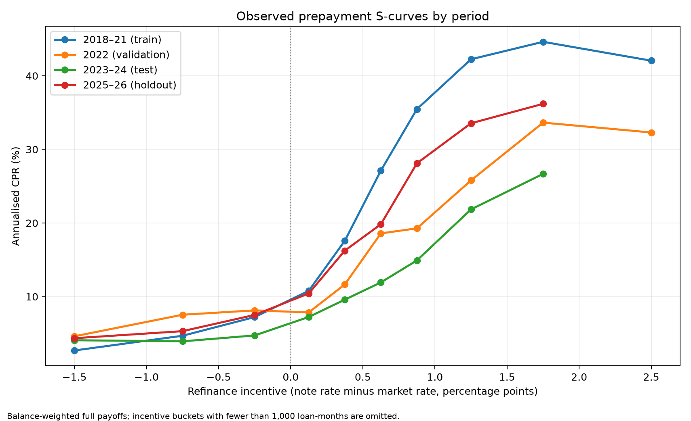
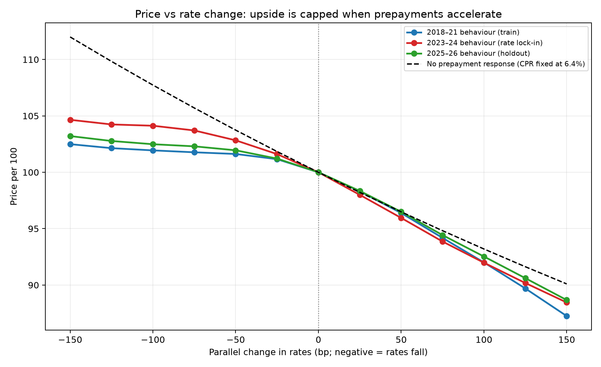
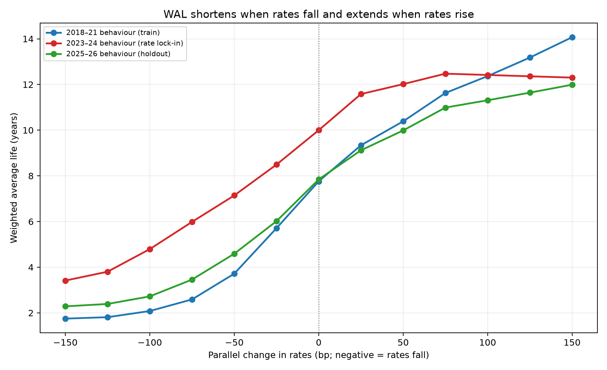
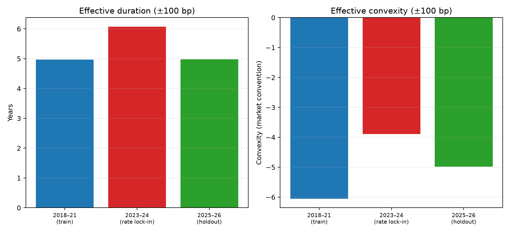
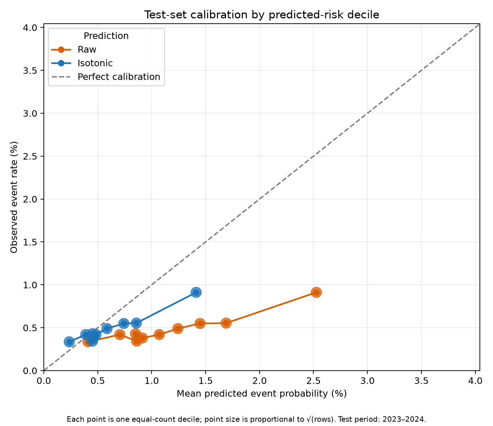
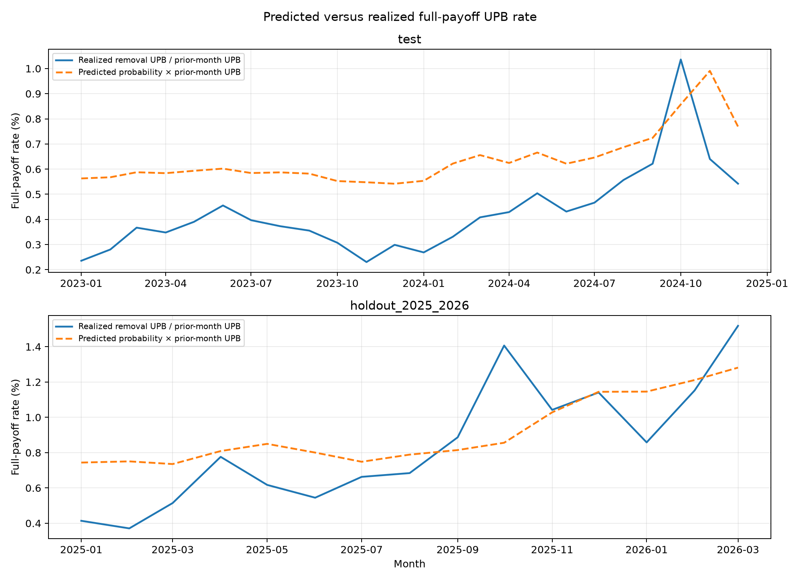
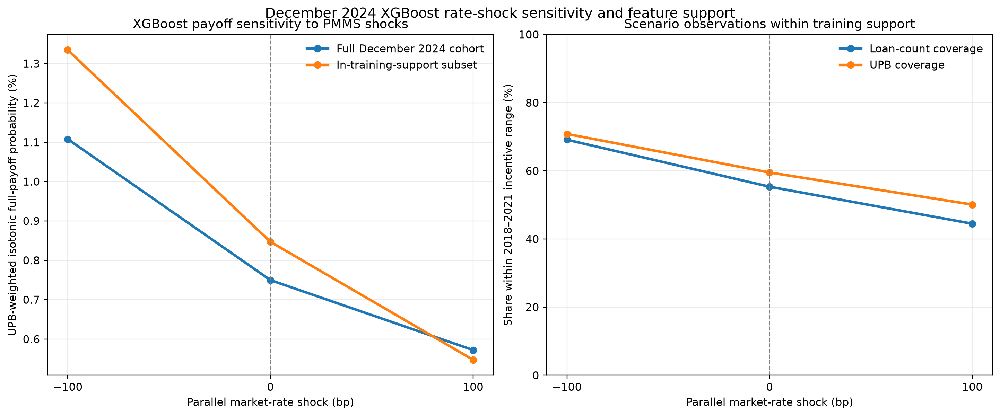

# Agency MBS Prepayment and Rate-Risk Analysis

This project uses Freddie Mac loan-level performance data and Freddie Mac
Primary Mortgage Market Survey (PMMS) mortgage rates to study mortgage
prepayments and their implications for agency mortgage-backed securities
(MBS).

It combines two complementary approaches:

1. **Empirical prepayment-curve valuation** — estimates observed
   refinance-incentive/payoff relationships across market regimes and
   translates them into illustrative MBS cash-flow, price, weighted-average
   life (WAL), duration, and convexity scenarios.
2. **Loan-level XGBoost payoff-risk modeling** — predicts one-month full
   voluntary payoff risk, evaluates performance out of time, compares
   predicted and realized payoff UPB, and tests rate-linked sensitivity within
   observed feature support.

The central question is:

> How does refinance incentive affect mortgage payoff behavior across market
> regimes, what does a loan-level machine-learning model add to the analysis,
> and what does that imply for MBS principal timing and interest-rate risk?

> **Important:** All valuation outputs are illustrative scenarios, not
> market-calibrated security prices, OAS valuations, investment advice, or
> recommendations. Pool-level price, WAL, duration, and convexity outputs use
> empirical prepayment curves, a hypothetical pass-through pool, fixed coupon
> and discount-yield assumptions, and simplified parallel rate shocks.
> XGBoost is used for loan-level full-voluntary-payoff prediction, forecast
> diagnostics, and bounded rate-sensitivity analysis; it is not the primary
> pool-level valuation input.

## Results

### Empirical prepayment S-curves



The balance-weighted empirical curves show that observed payoff speeds generally
rise with refinance incentive. The relationship differs across market periods,
consistent with changing rate environments, seasoning, burnout, borrower
composition, and mortgage-rate lock-in effects.

### Price sensitivity to rate shocks



### Weighted-average life sensitivity



### Empirical duration and convexity



These price, WAL, duration, and convexity figures come from the empirical
prepayment-curve cash-flow framework. They are not calculated from XGBoost
probabilities.

### XGBoost calibration by predicted-risk decile



The calibration chart compares predicted with observed full-voluntary-payoff
rates across equal-count test-set risk deciles. Isotonic calibration moves the
scores closer to observed event rates, though calibration remains
period-dependent.

### Predicted versus realized payoff-UPB rate



The monthly diagnostic compares realized full-payoff UPB with predicted
full-payoff probability multiplied by beginning UPB. It makes aggregate
forecast bias and month-to-month variation visible in both the test and
holdout periods.

### XGBoost rate sensitivity and feature support



The XGBoost model produces the expected directional response to refinance
incentive: falling market rates increase predicted full-payoff risk, while
rising market rates reduce it. The second panel reports the share of loans and
UPB whose scenario input remains within the model's 2018–2021 training range.

## Key findings

- Observed payoff speed generally rises with refinance incentive, but the
  relationship changes across market regimes.
- The 2023–2024 empirical curve is flatter than the 2018–2021 curve over much
  of the positive-incentive range, consistent with a rate-lock-in environment
  and changing loan/borrower composition.
- The empirical valuation produces effective duration between approximately
  5.0 and 6.1 years across the evaluated periods and negative convexity in
  every period.
- For the 2023–2024 empirical curve, a 100 bp rate rally increases assumed
  payoff speed, shortens WAL, and raises illustrative price; a 100 bp rate
  selloff reduces payoff speed, extends WAL, and lowers price.
- XGBoost provides a validated loan-level payoff-risk signal: holdout ROC-AUC
  is 0.6588, and holdout predicted payoff dollars equal 1.081x realized payoff
  dollars.
- XGBoost payoff probabilities move directionally with PMMS-linked refinance
  incentive shocks, but feature support declines under higher-rate scenarios.
  The empirical curve remains the primary input to pool-level valuation.

## Project workflow

1. **Data preparation** — Load Freddie Mac loan-level performance records and
   historical PMMS mortgage rates.
2. **Panel construction** — Build a monthly loan-level panel and identify
   voluntary payoff events.
3. **Feature engineering** — Construct refinance incentive, seasoning,
   burnout, calendar, lagged loan, and categorical features.
4. **Hazard modeling** — Train logistic-regression and XGBoost models for
   loan-month full-voluntary-payoff risk.
5. **Temporal evaluation** — Use chronological train, validation, test, and
   holdout partitions instead of random loan-month splits.
6. **Empirical prepayment analysis** — Estimate balance-weighted payoff rates
   by refinance-incentive bucket and annualize them into CPR-style assumptions.
7. **Illustrative cash-flow valuation** — Convert empirical annualized payoff
   assumptions to monthly SMM and project scheduled principal, prepayments,
   interest, price, WAL, duration, and convexity.
8. **XGBoost validation and model-risk checks** — Evaluate discrimination,
   calibration, payoff-UPB forecasts, base-score reproducibility, PMMS-shock
   sensitivity, and feature support.

## Data

### Freddie Mac loan-level performance data

The project uses the
[Freddie Mac Single-Family Loan-Level Dataset](https://www.freddiemac.com/research/datasets/sf-loanlevel-dataset).
Freddie Mac provides loan-level origination and monthly performance data through
its research-data platform; registration and current data terms apply.

Raw source data are not included in this repository. Download data directly
from Freddie Mac and place it in the local locations expected by the scripts,
typically under `data/raw/`.

Do not commit raw downloaded data unless redistribution is permitted and the
files have been reviewed for restrictions.

### Mortgage-rate data

The project uses historical
[Freddie Mac PMMS mortgage-rate data](https://www.freddiemac.com/pmms/pmms_archives)
to construct refinance incentive. Download the series required by
`src/prepare_pmms.py`, ensuring its dates and columns match the preparation
script.

## Data and target definitions

The processed dataset is a loan-month panel containing loan characteristics,
servicing/performance fields, market-rate features, and event labels.

### Refinance incentive

Refinance incentive is:

\[
Refinance incentive = borrower note rate − prevailing PMMS mortgage rate.
\]

A positive value indicates a potential rate-saving incentive to refinance.
A negative value indicates that replacing the loan at prevailing market rates
is generally less attractive on rate alone.

### Full-voluntary-payoff target

The XGBoost event is based on Freddie Mac zero-balance code `01`:
**“Prepaid or Matured (Voluntary Payoff).”** It is a full-loan termination
event, not a pure-refinance label and not a measure of all principal
reductions. Freddie Mac’s user guide identifies zero-balance code `01` as a
voluntary payoff event. [Freddie Mac user-guide mirror](https://usermanual.wiki/Document/userguide.343559074.pdf)

This distinction matters:

- **XGBoost target:** one-month probability of full voluntary payoff.
- **Empirical valuation input:** balance-weighted payoff behavior transformed
  into a CPR-style annualized assumption for illustrative cash flows.
- **Total CPR:** a broader pool-level convention that should not be assumed
  equivalent to a full-payoff event probability.

## Modeling and evaluation

The project uses chronological partitions to avoid random time leakage:

| Partition | Period | Primary use |
|---|---|---|
| Train | 2018–2021 | Feature/model estimation and internal tuning |
| Validation | 2022 | Probability calibration |
| Test | 2023–2024 | Out-of-time evaluation |
| Holdout | 2025–2026 | Later-period robustness evaluation |

Chronological evaluation is important because a random loan-month split can
mix observations from different mortgage-rate regimes across training and
evaluation data.

Model evaluation includes:

- ROC-AUC and average precision for ranking quality
- Brier score and log loss for probability quality
- Calibration-by-decile diagnostics
- UPB-weighted predicted-versus-realized payoff diagnostics

## XGBoost payoff-risk results

The XGBoost model estimates a one-month probability of full voluntary payoff.
It is a loan-level classification model, not a direct total-CPR model and not
a standalone market-calibrated MBS valuation engine.

| Split | Rows | Events | ROC-AUC | Average precision | Brier score | Log loss |
|---|---:|---:|---:|---:|---:|---:|
| Test, 2023–2024 | 1,389,985 | 6,723 | 0.5801 | 0.00906 | 0.004810 | 0.030471 |
| Holdout, 2025–2026 | 1,101,653 | 8,588 | 0.6588 | 0.02117 | 0.007691 | 0.043867 |

### Actual versus predicted payoff UPB

| Split | Realized full-payoff UPB rate | Isotonic predicted rate | Predicted / actual payoff dollars |
|---|---:|---:|---:|
| Test, 2023–2024 | 0.442406% | 0.647545% | 1.464x |
| Holdout, 2025–2026 | 0.849747% | 0.918625% | 1.081x |

The model ranks loan-level payoff risk better in the later holdout than in the
2023–2024 test period. Aggregate overprediction remains material in the test
period, so the project emphasizes ranking, calibration, and aggregate
payoff-UPB diagnostics rather than presenting XGBoost as a direct CPR forecast.

## XGBoost rate-shock sensitivity and support audit

The December 2024 base XGBoost scores reproduced exactly for all **68,057**
active test loans. A PMMS-linked scenario diagnostic then changed lagged
refinance incentive consistently with a parallel market-rate move:

- A **−100 bp market-rate shock** increases refinance incentive by
  1.0 percentage point.
- A **+100 bp market-rate shock** decreases refinance incentive by
  1.0 percentage point.

| Market-rate shock | UPB-weighted isotonic full-payoff probability | Loans within training support | UPB within training support |
|---|---:|---:|---:|
| −100 bp | 1.1079% | 69.1% | 70.8% |
| Base | 0.7497% | 55.3% | 59.5% |
| +100 bp | 0.5721% | 44.5% | 50.1% |

The predicted direction is economically consistent: falling market rates raise
refinance incentive and predicted full-payoff probability. However, a material
low-incentive portion of the December 2024 cohort lies outside the 2018–2021
training range, especially under a rate increase.

This is **not an implementation mistake**. It is a model-validation finding:
the 2024 rate-lock-in cohort contains incentive values that were not fully
represented during the 2018–2021 training period. Reporting the support
boundary prevents untested extrapolation from being presented as a validated
valuation output.

Accordingly, XGBoost shock outputs are reported as bounded loan-level
sensitivity diagnostics. They are not used as the primary source of CPR,
price, WAL, duration, or convexity.

## Empirical prepayment curves

For each market period, the project calculates balance-weighted monthly payoff
rates across refinance-incentive buckets and annualizes them into CPR-style
assumptions. The cash-flow engine converts the annualized assumption to
single-month mortality (SMM) for monthly principal projection.

The resulting S-curves show that payoff speeds generally rise with refinance
incentive, but the strength of the relationship differs by period.

The 2023–2024 curve is flatter than the 2018–2021 curve over much of the
positive-incentive range. This is consistent with lower observed refinance
responsiveness during the rate-lock-in period. It does not establish that
borrower preferences changed: period differences can also reflect burnout,
seasoning, borrower composition, home-sales activity, servicing behavior,
market conditions, and limits of public loan-level fields.

Thin incentive buckets are excluded from plotted curves to reduce sensitivity
to noisy estimates.

## Illustrative valuation assumptions

> **Important interpretation:** The valuation outputs are scenario-analysis
> results for a hypothetical pass-through pool. They are not observed security
> prices, market quotes, market-calibrated valuations, OAS analyses, or
> investment recommendations.

The empirical prepayment curves—not XGBoost probabilities—assign pool-level
CPR-style assumptions under parallel rate shocks. These assumptions are
converted to monthly SMM and applied to a hypothetical pass-through pool to
project scheduled principal, prepayments, interest, price per 100, WAL,
effective duration, and effective convexity.

The results depend on assumptions and conventions in `valuation_baseline.py`,
`valuation_empirical.py`, and figure-generation scripts. The cash-flow engine
uses a hypothetical pool, fixed coupon and discount-yield assumptions,
empirical incentive-bucket relationships, and simplified parallel rate shifts.

For the 2023–2024 empirical curve, the `±100 bp` scenario produced:

| Scenario | Annualized payoff assumption | Price per 100 | WAL |
|---|---:|---:|---:|
| Rates −100 bp | 17.23% | 104.13 | 4.79 years |
| Base case | 6.40% | 100.00 | 10.00 years |
| Rates +100 bp | 3.97% | 91.98 | 12.42 years |

At this shock size, the illustrative pool's effective duration is **6.07 years**
and its effective convexity is **−3.89** under the convention used in the code.
These figures describe this model setup only and should not be generalized to
a specific traded MBS or security.

## Comparing the approaches

The project compares two complementary prepayment-analysis approaches, not two
identical valuation engines.

| Dimension | Empirical prepayment-curve approach | XGBoost payoff-risk approach |
|---|---|---|
| Unit of analysis | Balance-weighted pool/incentive bucket | Individual loan-month |
| Target | Observed payoff behavior annualized for CPR-style scenarios | One-month full-voluntary-payoff probability |
| Main drivers | Refinance-incentive bucket and market regime | Incentive, lags, seasoning, burnout, calendar, and loan characteristics |
| Validation | Historical curve behavior and cash-flow scenario plausibility | Chronological test/holdout metrics, calibration, and payoff-UPB forecast |
| Rate-shock role | Annualized payoff assumption → SMM → cash-flow valuation | Directional payoff-risk sensitivity with feature-support audit |
| Pool-level duration/convexity | Yes, illustrative empirical result | No, not reported as a final result |
| Key limitation | Historical buckets mix borrower types | Full-payoff target and scenario support limit valuation use |

The empirical approach provides a transparent, valuation-ready pool-level
assumption. XGBoost adds loan-level payoff-risk ranking, probability
diagnostics, actual-versus-predicted UPB analysis, and a stress-tested
rate-sensitivity view.

A future extension could combine the strengths of both approaches by modeling
a total-prepayment target, generating scenario-consistent future mortgage-rate
paths, refreshing path-dependent features monthly, and validating projected
cash flows against relevant security or benchmark analytics.

## Repository structure

```text
.
├── data/
│   ├── raw/                         # Downloaded source data; not committed
│   └── processed/                   # Processed panels and development samples
├── src/                             # Data preparation, feature, and model scripts
├── outputs/
│   ├── figures_final/               # Final figures
│   ├── model_scenario_eda/          # XGBoost scenario/support-audit outputs
│   ├── models/                      # Saved models and metric tables
│   ├── predictions/                 # Loan-month predictions
│   ├── reports/
│   │   └── model_validation/        # Model metrics and validation reports
│   └── valuation_baseline/          # Empirical cash-flow and scenario outputs
├── audit_xgb_rate_shock_support.py  # XGBoost base-score/support audit
├── make_final_figures.py
├── make_model_diagnostics.py
├── make_xgb_final_figures.py
├── summarize_xgb_shock_support.py
├── valuation_baseline.py
└── valuation_empirical.py
```

Some directories are created when scripts run and may not be present in a
fresh clone.

## Reproducing the analysis

Run commands from the repository root. The dataset is not bundled with this
repository, and exact raw-input locations depend on the downloaded data and
script path settings.

1. Clone the repository and enter it:

   ```bash
   git clone https://github.com/parthkhandelwal9193/mbs-prepayment.git
   cd mbs-prepayment
   ```

2. Create and activate a virtual environment:

   ```bash
   python3 -m venv .venv
   source .venv/bin/activate
   ```

3. Install dependencies:

   ```bash
   python -m pip install --upgrade pip
   python -m pip install -r requirements.txt
   ```

   If `requirements.txt` is absent or incomplete, inspect imports and record
   the environment before claiming full reproducibility.

4. Download Freddie Mac loan-level data and PMMS rates from the official
   sources above. Place them in the locations expected by the scripts.

5. Run the preparation and model pipeline after checking each script's paths:

   ```bash
   python src/prepare_pmms.py
   python src/build_panel.py
   python src/add_rate_features.py
   python src/build_hazard_sample.py
   python src/validate_features.py
   python src/train_xgboost_hazard.py
   ```

6. Generate empirical valuation outputs and final empirical figures:

   ```bash
   python valuation_baseline.py
   python valuation_empirical.py
   python make_final_figures.py
   ```

7. Generate XGBoost diagnostic and support-audit outputs after model training
   and prediction files exist:

   ```bash
   python make_model_diagnostics.py
   python validate_model_payoff_upb.py
   python audit_xgb_rate_shock_support.py
   python summarize_xgb_shock_support.py
   python make_xgb_final_figures.py
   ```

8. Compare regenerated outputs with the saved figures and tables. Results can
   change if source-data releases, package versions, model settings, or random
   seeds differ.

## Limitations and interpretation

- Public Freddie Mac loan-level data do not contain all household,
  property-market, transaction, credit, and servicing factors that can drive
  turnover-related payoffs.
- Zero-balance code `01` is “Prepaid or Matured (Voluntary Payoff),” not a
  pure refinance label and not total CPR.
- Empirical incentive buckets combine loans with different seasoning, credit,
  geography, origination, borrower, and servicing characteristics. The curves
  are descriptive, not fully causal estimates.
- The empirical cash-flow engine uses a hypothetical pool, fixed
  coupon/discount-yield assumptions, simplified parallel shocks, and
  historical incentive/payoff relationships. It is not calibrated to a
  specified security, yield curve, spread, option cost, or OAS.
- XGBoost is validated as a one-month loan-level full-payoff model, not as a
  total-CPR or security-pricing model.
- The XGBoost rate-shock diagnostic changes lagged refinance incentive but
  does not simulate a complete future rate path or refresh every
  path-dependent borrower feature month by month.
- The support audit identifies a material cohort share outside the XGBoost
  training range under rate shocks. This is a validation result—not a mistake:
  it prevents untested extrapolation from being represented as validated
  valuation output.
- A production MBS valuation model would require a complete pool/security
  specification, market-consistent interest-rate paths, a validated
  total-prepayment/termination model, partial-principal behavior, benchmark
  pricing, and spread/OAS calibration.